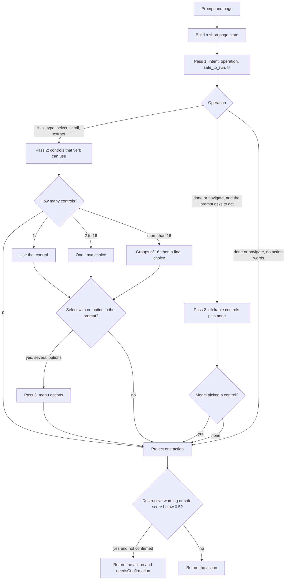

# Decision

`POST /decide` takes the prompt, a confirmed flag, the recent transcript, and the page. It returns a reply, a backend name, whether a person must confirm, and at most one action.

Laya answers typed questions in one forward pass per question set. A choice question has a fixed list of labels. Those labels share one head of about 192 tokens, so a long list of controls cannot be one question. The brain therefore asks in passes, and groups a pass that is still too wide.

## Pass 1, always the same questions

The page does not change these labels.

| Id | Type | Labels |
| --- | --- | --- |
| `intent` | choice | `control_page`, `answer`, `clarify` |
| `operation` | choice | `click`, `type`, `select`, `scroll`, `navigate`, `extract`, `done` |
| `safe_to_run` | noul | Is it safe to run immediately, without paying, deleting, sending, or submitting? |
| `fit` | score | `impossible`, `poor`, `partial`, `good`, `exact` |

The state text is the request, the last four transcript lines, the page title and URL, and up to 24 controls. It is cut at 4000 characters. The full control list is not repeated here. Pass 2 carries the names.

## Pass 2, the control list

Only the controls that match the verb are offered. Ids that are not `[A-Za-z0-9_-]+` are dropped.

| Verb | Who is listed |
| --- | --- |
| `click` | Links, buttons, checkboxes, radios, switches, menu items, tabs, summary elements |
| `type` | Editable fields, text boxes, search boxes, text areas |
| `select` | `select`, combobox, listbox |
| `scroll` | Every control above, plus `page` for scrolling the page itself |
| `extract` | Every control that has a verb |

A label is the accessible name, at most 48 characters, plus the link host when there is one, cut at 64 characters. The choice key is the element id.

One matching control is used immediately, with no extra model call. Two through sixteen are one choice. More than sixteen are split into groups of at most sixteen. Each group is its own question in one `predict` call. The winner of each group goes to the next round, for at most eight rounds, and a final call answers the survivors. A winner that is not one of that group's labels is discarded. If a round cannot shrink the list, the remaining labels go to the final call.

`navigate` and `done` skip this pass unless the prompt asks to open, click, type, choose, scroll, or go somewhere, and it is not a question (no `?`). That rescue pass is the click list plus `none`. Picking `none` leaves the verb as it was. Picking a control changes the verb to `click` on that control.

## Pass 3, menu options

If the verb is `select`, the prompt did not already name an option (`choose Red in Color`, or a quoted string), and the chosen element listed options, the brain asks which option. At most 40 labels, one model call when there are several, and the single option is taken directly when there is only one. The chosen label must match one the page reported.

## Projection

After the passes, `project_decision` builds the action. It does not ask the model again.

| Operation | Action |
| --- | --- |
| `click`, `scroll`, `extract` | That type, with the chosen element id. Scroll with no element scrolls the page. |
| `type` | Text parsed from the prompt into an editable field. Missing quotes produce a reply and no action. |
| `select` | Option from the prompt, otherwise the pass-3 label. |
| `navigate` | `https` URL parsed from the prompt, including a bare host such as `google.com`. |
| `done` | No action. A question gets a short description of the page. Anything else asks for a control. |

If the model says `navigate` and the prompt names a control on the page, the action becomes a click on that control. If it says `done` but the prompt uses an action verb, a control whose name or address matches is clicked. If nothing matches and the prompt contains an address, the action is navigation.

A compound label such as `click:e5` is still accepted: the verb and the id are split, and the id must exist on the page.

Text for `type` and the URL for `navigate` always come from the prompt. The model does not supply them.

## Confirmation

The action is held when both of these are true:

- the operation is `click`, `type`, `select`, or `navigate`
- the prompt or the control name matches a destructive word (`delete`, `pay`, `submit`, `send`, and the rest of that list), or `safe_to_run` is below 0.5

The gateway stores the action on the tab and does not enqueue it. The reply says to confirm. The next request with `confirmed: true` and no new message releases that held action. The brain is not called again. The extension then receives the command like any other.

## Heuristic

Until the checkpoint is ready, or if a pass throws, the same answer shape is produced without Laya. The verb comes from the wording (`click`, `type`, `open`, a URL, a question). The control comes from overlapping tokens between the prompt and each control's name, role, and address. Projection and the confirmation rule are shared, so tests and the live heuristic return the same action shape.

## Reply

The reply is a sentence built from the action: `Click “Gmail”.`, `Type “hello” into “Search”.`, `Open https://example.com.`, and so on. `decision.answers` keeps the raw Laya (or heuristic) objects, including probabilities when the checkpoint produced them. `decision.routing` records which checkpoint Laya used.
