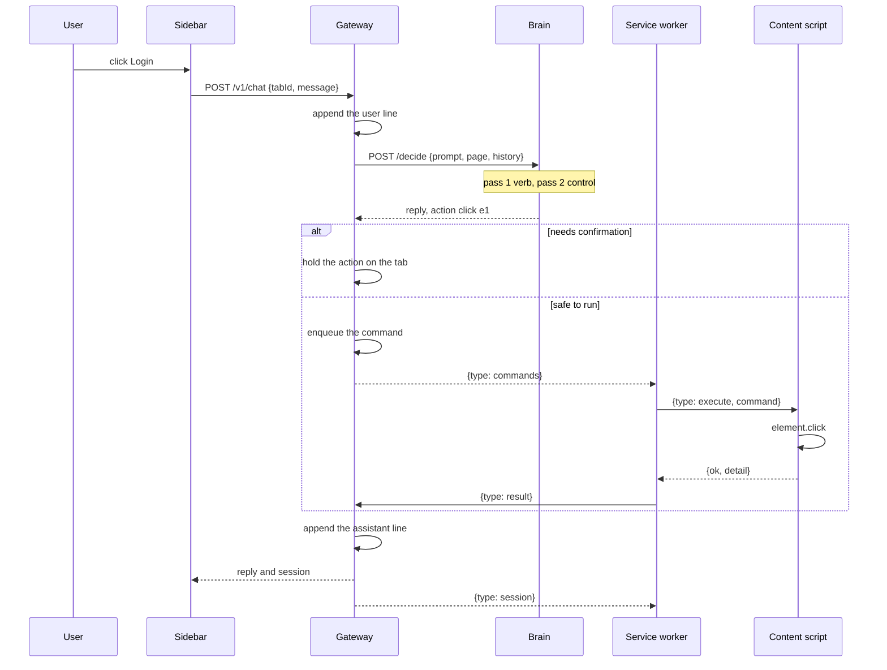
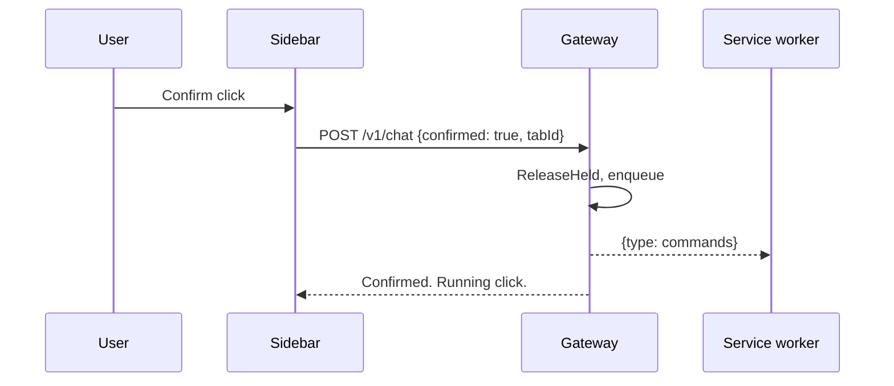
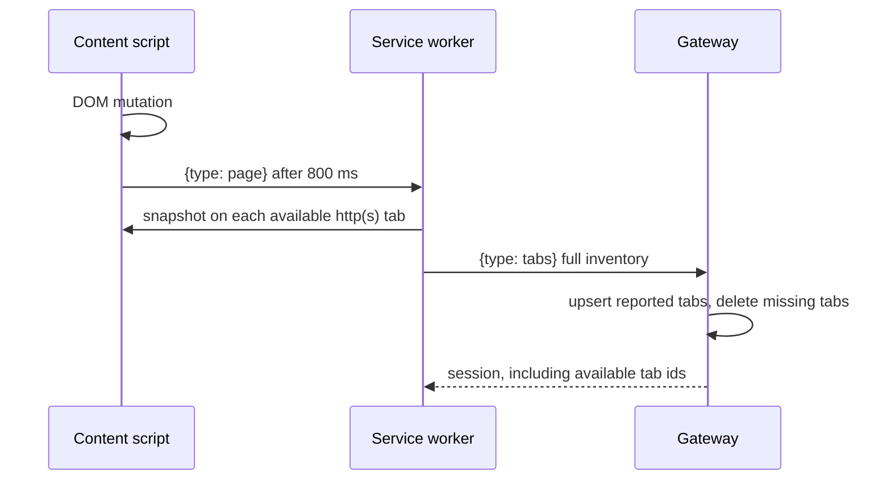
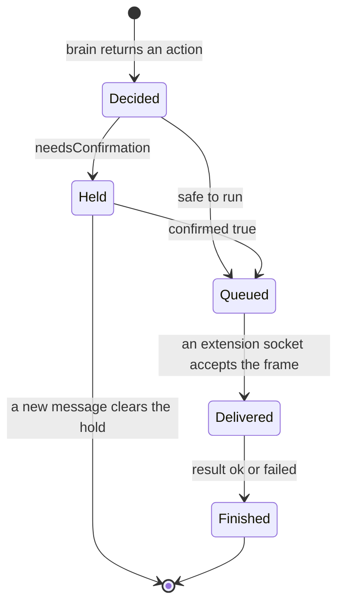
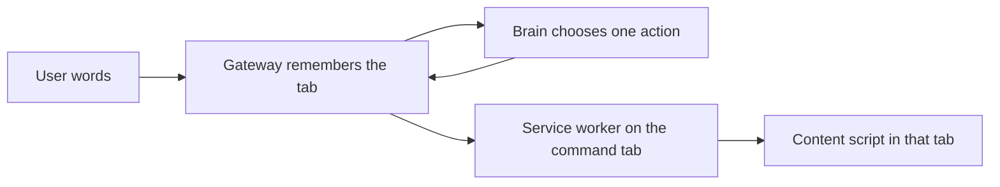

# Flows

These sequences are the paths a person actually hits. The component picture is in [System](system.md). The question list is in [Decision](decision.md).

## Send a command from the sidebar

The composer is cleared and disabled as soon as Send is pressed, before the brain returns. A second press is ignored while the request is in flight. The text is restored only when the request fails.

The user line is stored before `/decide` returns. A slow checkpoint load leaves that line on screen with no assistant line yet. That is one request, not a reload of the sidebar.

The command desk uses the same `POST /v1/chat`. Its `tabId` is the tab selected in the desk, which can differ from the browser's active tab.

The same request stays active after the click. When the tab reports a new address, the gateway decides again with the original words. It stops when the next decision has nothing to do, when the address or title already contains the destination (no checkpoint load), when the next click would repeat the same control, or after four actions. A click that has not changed the address yet keeps the request armed instead of stopping early. A confirmation still pauses the loop until the person confirms. A name match ignores spaces and prefers the longest name, so “signin” selects “Sign in” rather than a shorter “Gmail” link.

## Confirm

If nothing is held, the gateway returns 409 `nothing is waiting for confirmation`.

## Page change

A title-only update does not publish. A completed load or a URL change does. Activation and removal do too.

## Command lifecycle

`TakeQueued` runs only after at least one extension socket accepts the frame. A desk socket never receives commands. Disabling a tab does not by itself cancel a command that was already delivered to the page.

## Failure points

| Condition | What the caller sees |
| --- | --- |
| Brain down or non-JSON | 502, and an assistant line that the decision service is unavailable |
| Tab missing | 409 `no open tab` |
| Tab unchecked in the desk | 409 `tab is not available` |
| Checkpoint still loading | `backend: heuristic`, same action shape |
| A later Laya pass throws | That pass is skipped. Projection uses the verb and name matching. |
| Content script missing | The result detail is the messaging error. The command is still finished. |
| Navigate to a non-http URL | The content script refuses. The brain also refuses to emit that action. |

## Where work is allowed to run

The brain never receives a live DOM handle. It receives the snapshot the extension last published. A command uses the `data-laya-id` values from that snapshot. If the page has been replaced and those ids are gone, execution reports that the element is missing.
