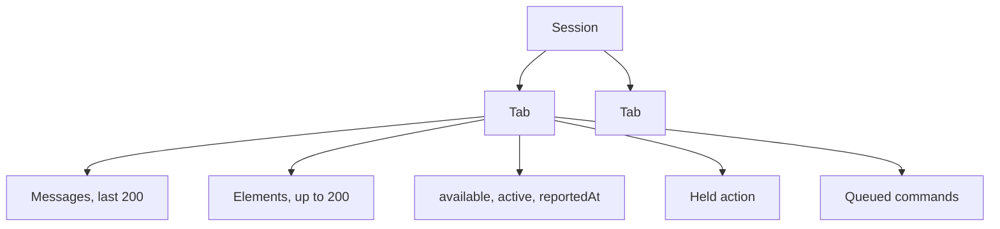
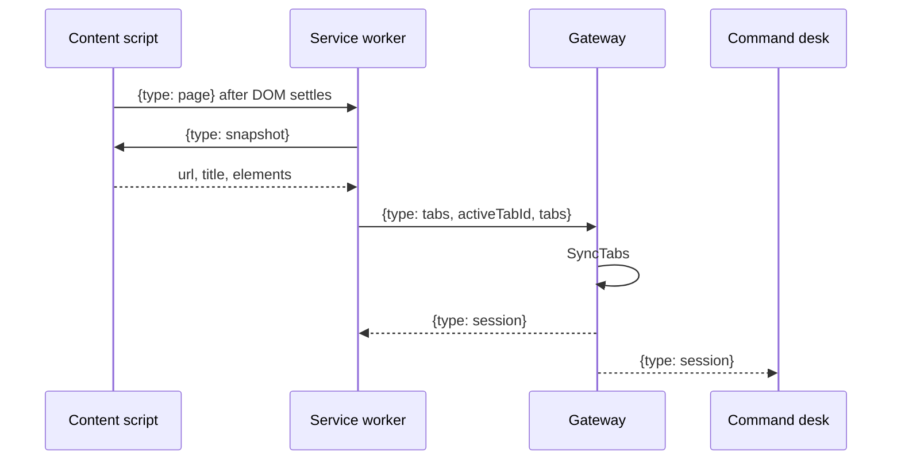

# Sessions and tabs

A session is a map of browser tabs plus, on each tab, a transcript, the latest control list, an availability flag, a held action, and command queue. The session id matches `[A-Za-z0-9_-]{1,64}`.

New tabs start available. The command desk turns a tab off with `POST /v1/tabs/availability`. Turning a tab off also drops its held action. Chat against an unavailable tab returns 409 `tab is not available`. Chat with no matching tab returns 409 `no open tab`. Omitting `tabId` uses the session's active tab.

Transcripts are per tab. `GET /v1/sessions/{id}?tabId=` returns that tab's messages and the full tab list. The sidebar watches the active tab. The desk watches the tab the operator selected.

`extensionConnected` on a view is true when that tab was reported within the last 8 seconds.

## How the inventory is built

The service worker opens one websocket:

`GET /v1/ws?sessionId=local&role=extension`

On open, and again when a tab is activated, removed, or finishes loading, it publishes every http(s) tab:

`SyncTabs` replaces the inventory. Tabs missing from the report are deleted, including their transcripts. An empty report therefore clears the session. That is why a partial snapshot must not use this path.

`POST /v1/extension/snapshot` is the older single-tab write. `SavePage` upserts that one tab and does not delete the others. The live extension uses the websocket `tabs` message, which is a full inventory.

Unavailable tabs are still listed, with an empty element list. The worker only asks the content script for elements when the tab is available. A tab whose id is not yet in `availableTabIds` is treated as available (`null` means "no opinion yet"). After each session frame the worker stores the ids the gateway marked available.

Publishes are coalesced. A new request during an in-flight publish schedules one more pass. The content script watches `documentElement` with a `MutationObserver` and notifies the worker 800 ms after the last mutation.

The desk connects as `role=ui`. Its first message is a session view. `watch` changes which tab's transcript is in later frames for that socket only. The sidebar sends `watch` for the active tab when it connects and again whenever the active tab changes, and the service worker forwards that on the extension socket. The desk watches whichever row is selected, which can be a different tab.

## Commands

A command is an action plus an id and a tab id. The gateway enqueues it on the tab. `pushCommands` peeks the queue, writes `{ "type": "commands" }` to extension sockets, and removes the queue only after a write succeeds. If the extension is disconnected, the commands stay queued. The HTTP `GET /v1/extension/commands` path still exists and also takes the queue. The live worker uses the websocket.

The worker runs each command by messaging that tab's content script, then sends `{ "type": "result", commandId, ok, detail }` back. `Finish` records the result on the tab and publishes a new session frame.

An alarm named `socket` fires every minute and only reconnects. Saving sidebar settings sends `{ "type": "tick" }`, which drops the socket key and connects again with the new base URL, session, or token.

## What a snapshot contains

The content script marks each visible interactive node with `data-laya-id` (`e1`, `e2`, …). The id stays on the node so a later command can find it. Collection stops at 200 nodes. The gateway trims to the same cap on snapshot, tab sync, and the websocket.

Included nodes:

- `a[href]`, `button`, `input`, `textarea`, `select`, `summary`
- roles `button`, `link`, `textbox`, `searchbox`, `checkbox`, `radio`, `combobox`, `listbox`, `option`, `menuitem`, `menuitemcheckbox`, `menuitemradio`, `tab`, `switch`
- `contenteditable="true"`

Hidden, disabled, `aria-hidden`, and `type=hidden` nodes are skipped. A `select` also carries up to 40 option labels. Password values are sent as an empty string.

Each element has `id`, `role`, `name` (accessible name, at most 120 characters), `tag`, `editable`, `inputType`, `value` (at most 80 characters), `href`, and optional `options`.
