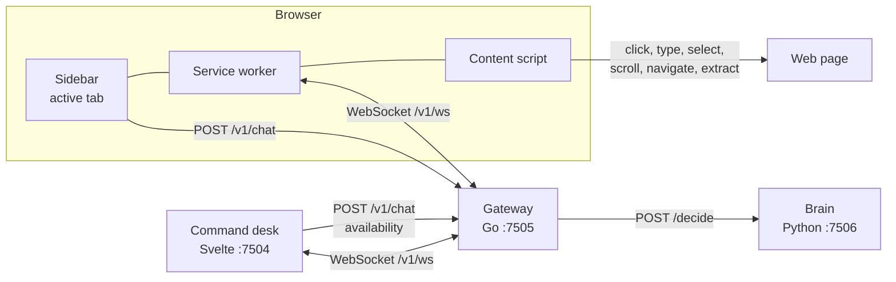

# System

Four programs share one session. Nothing in the browser calls the brain directly. The gateway is the only process that stores tabs, transcripts, and commands.

## Programs

| Directory | Process | Listens | Responsibility |
| --- | --- | --- | --- |
| `extension/` | Chrome MV3 extension | Inside the browser | Collect controls, keep one websocket, run commands on a tab |
| `chat/` | Vite dev server, Svelte UI | `0.0.0.0:7504` | List tabs, enable or disable them, send a command to one tab |
| `gateway/` | Go HTTP server | `0.0.0.0:7505` | Session store, websocket fan-out, call the brain |
| `brain/` | Python HTTP server | `0.0.0.0:7506` | Ask Laya, project the answer into one action |

`scripts/dev.sh` starts the three servers. The extension is loaded unpacked. The toolbar icon opens the sidebar (`sidePanel`, not a popup).

The gateway's `AGENT_URL` defaults to `http://127.0.0.1:7506`. Its HTTP client waits up to 180 seconds because the first English prompt can load a large checkpoint onto the GPU.

## What each UI is for

The sidebar is bound to the active tab. It shows that tab's transcript, sends `POST /v1/chat` with that tab id, and receives session updates through a port to the service worker (`chrome.runtime.connect({ name: "sidebar" })`). It does not poll.

The command desk is the inventory. It lists every http(s) tab the extension has reported, shows which are available, and can send a message to the tab that is selected there. Selecting a tab sends `{ "type": "watch", "tabId" }` on its websocket so later session frames are that tab's transcript.

Both UIs must use the same session id. The default is `local`.

## Trust and auth

The gateway store is in memory. Restarting it drops transcripts, tab inventory, and queued commands.

If `API_TOKEN` is set, every HTTP route except the websocket requires `X-Api-Token`. The websocket cannot set that header, so it accepts the same value as `?token=`. The extension and the desk store the token locally and attach it themselves.

The brain has no token. It is meant to be reached only from the gateway. The extension never sees the brain URL.

Navigation is limited to `http://` and `https://` in both the brain and the content script. Password field values are omitted from the snapshot. Typed text and destination URLs are taken from the user's words, not invented by the model.

## Checkpoints

`LAYA_MODE` is `auto`, `on`, or `off`.

| Mode | Behavior |
| --- | --- |
| `auto` | Load the checkpoint on a background thread. Until it is ready, decide with the heuristic. |
| `on` | Load before serving. |
| `off` | Heuristic only. |

`GET /health` on the brain reports `laya` as `loading`, `ready`, `unavailable`, or `disabled`. The gateway's `GET /v1/status` proxies that.

With `LAYA_WARMUP=1` the process runs one tiny decision at startup so weights are resident. Laya's own router then picks the English or multilingual checkpoint from the prompt. A short Latin prompt can stay on the multilingual checkpoint. The first prompt that needs the English checkpoint pays for loading that file. Later decisions reuse it.

`backend` on a decision is `laya` when a checkpoint answered, and `heuristic` when it did not. The action shape is the same either way.
